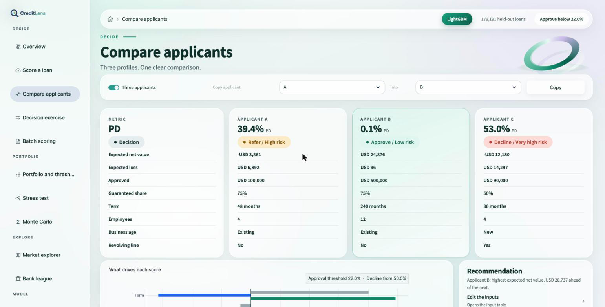
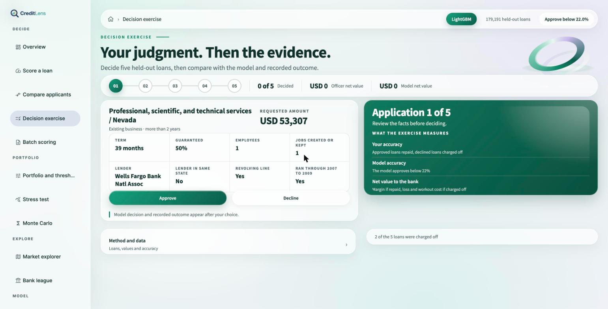
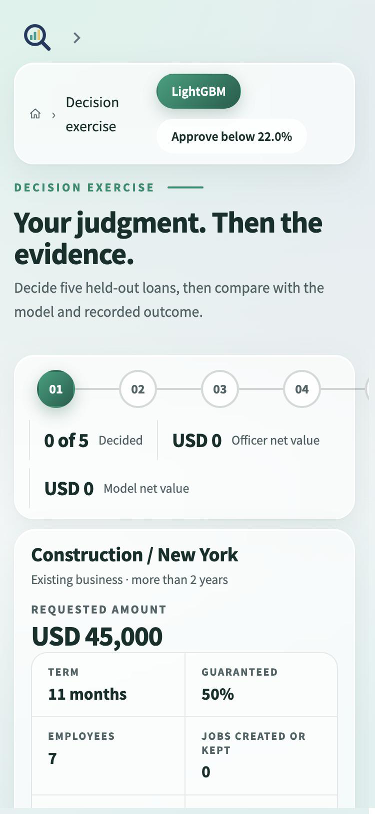
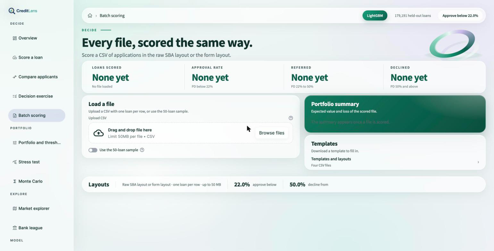
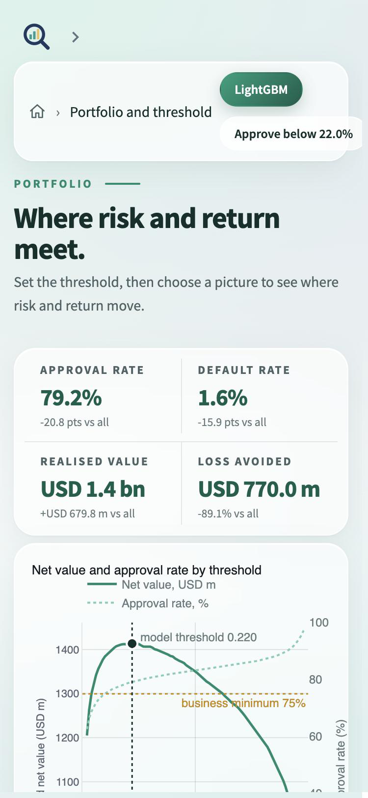
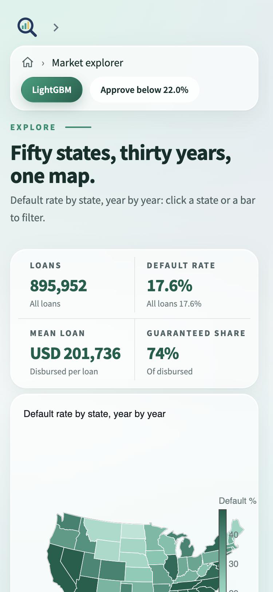
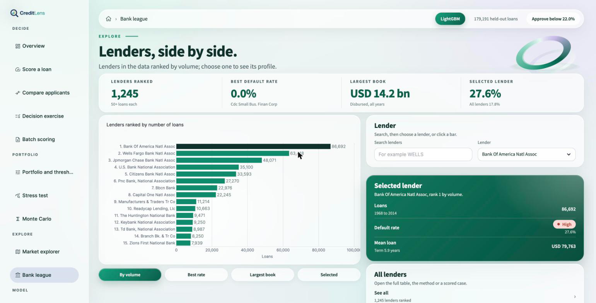
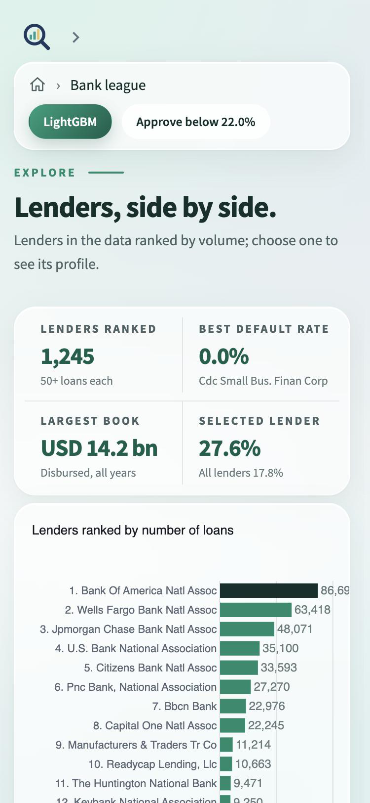
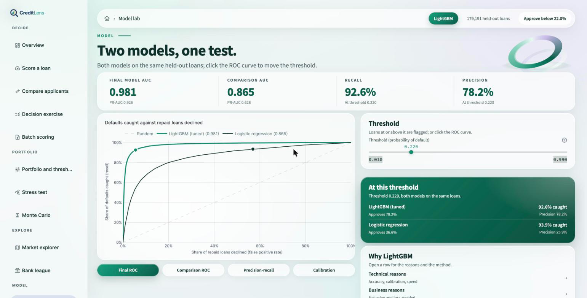
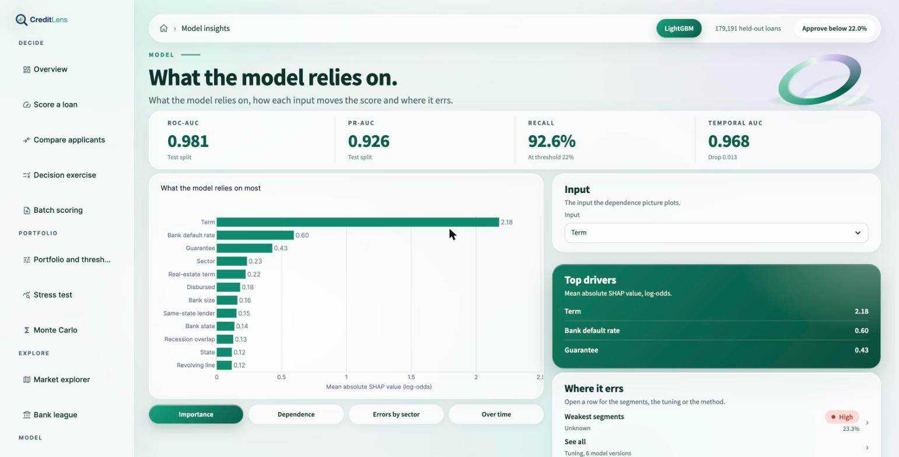

# CreditLens: SME Loan Default Risk Scoring

CreditLens is a decision-support tool for a bank's SME credit desk lending under a government loan-guarantee scheme. Under such a scheme the guarantor covers part of each loan and the bank carries the rest, so a charged-off loan costs the bank the unguaranteed principal plus workout cost, while a wrongly declined good borrower costs the bank its interest margin and costs the economy the jobs the loan would have supported. Using 899,164 US Small Business Administration (SBA) 7(a) loan records, we build a classifier that estimates the probability of default at application time and recommends whether to approve, refer for manual review or decline, together with the expected value of the loan and an explanation of the score. The same mechanism operates in the UAE through the Emirates Development Bank credit guarantee scheme and the Khalifa Fund, and the tool is framed for a UAE bank that would retrain it on its own portfolio.

Course project for CDS4003 Data Science for Business Application (HCT), organised around the six CRISP-DM phases.

**Live app:** https://creditlens-sme.streamlit.app

## Team

| Member | Role | GitHub |
|---|---|---|
| Mansoor Mohamed Mansoor Saeed Alwahedi (team lead) | Business understanding, modelling and tuning (notebooks 04, 05), report integration, repository admin | [mansooraw](https://github.com/mansooraw) |
| Salem Adel Salem Alshamlan Almarri | Data collection, data understanding and cleaning (notebooks 01, 02), data dictionary, dataset search evidence | shared repository (see note) |
| Sultan Zayed Ahmed Saeed Alkindi | EDA and feature engineering (notebook 03), Streamlit app and deployment, figures | shared repository (see note) |

The team works in this single repository on the team lead's account. Each commit covers one stage of the project and its message names the content; the header of every notebook and document names its author.

## Objectives

1. Build a default-risk classifier with ROC-AUC of at least 0.80 and recall on defaulted loans of at least 0.70 on a held-out test set, by Week 13.
2. Reduce expected charge-off loss on the held-out portfolio by at least 25% compared with the approve-everything policy, at an approval rate of at least 75%, using an explicit cost matrix, by Week 14.
3. Deploy a public Streamlit app that returns a scored decision with an explanation in under 3 seconds per loan, by Week 14.

The full problem statement is in [docs/business_problem.md](docs/business_problem.md).

## Dataset

| Item | Detail |
|---|---|
| Name | "Should This Loan be Approved or Denied?" (`SBAnational.csv`) |
| Source | Kaggle, uploaded by Mirbek Toktogaraev: https://www.kaggle.com/datasets/mirbektoktogaraev/should-this-loan-be-approved-or-denied |
| Original provenance | US SBA 7(a) loan records, published with Li, M., Mickel, A. and Taylor, S. (2018) *Journal of Statistics Education*, 26(1), 55-66, https://doi.org/10.1080/10691898.2018.1434342 |
| Licence | CC BY-SA 4.0 (Kaggle dataset); CC BY 4.0 (paper) |
| Size | 899,164 rows, 27 columns, 179 MB |
| Target | `Default` = 1 if `MIS_Status` is `CHGOFF`, 0 if `P I F`; 17.56% of the 897,167 labelled loans defaulted |

The raw file exceeds GitHub's 100 MB limit and is not committed. `python src/download_data.py` downloads it with `kagglehub` (no API key needed) into `data/raw/`. A 5,000-row sample is committed in `data/sample/`. The search that led to this dataset is documented in [docs/dataset_search_evidence.md](docs/dataset_search_evidence.md) and every column is described in [docs/data_dictionary.md](docs/data_dictionary.md).

## Repository structure

```
sme-credit-risk/
├── README.md
├── requirements.txt
├── .gitignore
├── data/
│   ├── raw/                  SBAnational.csv (git-ignored, see download step)
│   ├── processed/            cleaned and feature parquet files
│   └── sample/               sba_sample_5000.csv
├── notebooks/
│   ├── 01_data_understanding.ipynb
│   ├── 02_data_cleaning.ipynb
│   ├── 03_eda_feature_engineering.ipynb
│   ├── 04_model_selection.ipynb
│   └── 05_tuning_evaluation.ipynb
├── src/
│   ├── config.py             paths, constants, cost assumptions
│   ├── download_data.py      fetches the raw data from Kaggle
│   ├── cleaning.py
│   ├── features.py
│   ├── modelling.py
│   └── evaluation.py
├── app/
│   ├── streamlit_app.py
│   ├── pages/
│   └── assets/
├── models/                   final_model.joblib, model_metadata.json, feature_schema.json
├── docs/
│   ├── business_problem.md
│   ├── dataset_search_evidence.md
│   ├── data_dictionary.md
│   ├── cleaning_log.md
│   ├── model_card.md
│   ├── milestones.md
│   ├── search_evidence/
│   └── figures/
└── reports/                  group report and individual assessments
```

## CRISP-DM mapping

| CRISP-DM phase | Where |
|---|---|
| Business Understanding | `docs/business_problem.md` |
| Data Understanding | `docs/dataset_search_evidence.md`, `docs/data_dictionary.md`, `notebooks/01_data_understanding.ipynb` |
| Data Preparation | `notebooks/02_data_cleaning.ipynb`, `notebooks/03_eda_feature_engineering.ipynb`, `docs/cleaning_log.md` |
| Modeling | `notebooks/04_model_selection.ipynb` |
| Evaluation | `notebooks/05_tuning_evaluation.ipynb` |
| Deployment | `app/`, `docs/model_card.md` |

## How to run

Requires Python 3.11 or later (the deployed app runs on Python 3.12). From the repository root:

```bash
# 1. Create and activate a virtual environment
python -m venv .venv
source .venv/bin/activate        # Windows: .venv\Scripts\activate

# 2. Install the pinned dependencies
pip install -r requirements.txt

# 3. Download the raw data into data/raw/
python src/download_data.py

# 4. Run the notebooks in order (01 to 05), interactively or headless
jupyter nbconvert --to notebook --execute --inplace notebooks/01_data_understanding.ipynb
jupyter nbconvert --to notebook --execute --inplace notebooks/02_data_cleaning.ipynb
jupyter nbconvert --to notebook --execute --inplace notebooks/03_eda_feature_engineering.ipynb
jupyter nbconvert --to notebook --execute --inplace notebooks/04_model_selection.ipynb
jupyter nbconvert --to notebook --execute --inplace notebooks/05_tuning_evaluation.ipynb

# 5. Start the app
streamlit run app/streamlit_app.py
```

All paths are resolved through `src/config.py`, and `RANDOM_STATE = 42` is used throughout, so the results are reproducible on any machine.

## Results summary

Test split: 179,191 held-out loans (20% stratified); cross-validation on the 716,761 training loans. Full tables are in `docs/model_comparison.csv`, `docs/tuning_before_after.csv` and `docs/policy_comparison.csv`; the interpretation is in `docs/evaluation_summary.md` and `docs/model_card.md`.

| Model | CV ROC-AUC | Test ROC-AUC | Test PR-AUC | Recall (defaults) | Precision (defaults) | Brier score |
|---|---|---|---|---|---|---|
| Dummy (prior) baseline | 0.500 | 0.500 | 0.176 | 0.000 | 0.000 | 0.145 |
| Logistic regression | 0.863 | 0.865 | 0.628 | 0.820 | 0.432 | 0.151 |
| Random forest | 0.955 | 0.958 | 0.865 | 0.679 | 0.890 | 0.056 |
| HistGradientBoosting | 0.973 | 0.974 | 0.908 | 0.803 | 0.883 | 0.041 |
| LightGBM (default settings) | 0.975 | 0.975 | 0.907 | 0.807 | 0.877 | 0.041 |
| **LightGBM (tuned, final)** | **0.980** | **0.981** | **0.926** | **0.926** at 0.22 | **0.782** at 0.22 | **0.035** |

Recall and precision for the comparison models are at a 0.5 cut-off; the final model is reported at its business threshold of 0.22, chosen on out-of-fold training predictions to maximise portfolio net value with the approval rate kept at 75% or above. Tuning raised the LightGBM test ROC-AUC from 0.9748 to 0.9807 and cut the Brier score from 0.0412 to 0.0352.

| Policy on the test portfolio | Approval rate | Default rate among approved | Net value (USD m) | Charge-off loss (USD m) |
|---|---|---|---|---|
| Approve every loan | 100% | 17.6% | 733.7 | 864.4 |
| Logistic regression at its own threshold (0.62) | 77.4% | 6.5% | 1,094.6 | 327.1 |
| LightGBM (tuned) at 0.22 | 79.2% | 1.64% | 1,413.5 | 94.4 |

| Objective | Target | Achieved |
|---|---|---|
| ROC-AUC on test set | at least 0.80 | 0.981 |
| Recall on defaults | at least 0.70 | 0.926 at the 0.22 threshold |
| Reduction in charge-off loss | at least 25% at an approval rate of at least 75% | 89.1% at a 79.2% approval rate (USD 770 m avoided on the test portfolio) |
| App response time | under 3 seconds per loan | about 0.2 seconds per loan once the model is cached (about 1 second including the explanation and similar-loan search) |

Temporal validation (train on fiscal years up to 2005, test on 2006 onwards) gives ROC-AUC 0.968 (against 0.981 on the random split) and shows the model under-predicts the 2006 to 2008 vintages, which is why the model card asks for monitoring and periodic retraining.

## App

CreditLens is deployed as a multipage Streamlit app (CRISP-DM Deployment phase) that works on a laptop, a tablet and a phone. The entry point is `app/streamlit_app.py`. Shared loading, cleaning, scoring, expected-value, explanation and chart code is in `app/utils.py` and reuses `src/cleaning.py` and `src/features.py`, so a loan entered in the app goes through exactly the same steps as the training data. `app/analytics.py` holds the pure computations behind the interactive pages (similar loans, objective thresholds, Monte Carlo, stress test, the decision exercise and shareable case links) and is unit-tested on its own.

The front end follows a written design system: `design-system/MASTER.md` sets the rules, `design-system/concepts/` holds the four concept images the pages were built from, `app/assets/tokens.css` holds every colour, size and duration, `app/assets/theme.css` styles the parts, and `app/ui.py` is the component kit (page bar with status pills, editorial title block, figure strip, glass cards, dark emerald panels, rows that open sheets, badges, facts grid, stepper). A page only composes kit parts; it never invents a colour or a size. `app/pages/kit.py` shows every part on one page.

**Run locally** from the repository root, after installing `requirements.txt`:

```bash
streamlit run app/streamlit_app.py
```

The app loads the final artefacts from `models/`. If they are not present it falls back to an interim development model in `app/_dev/` (git-ignored), which `python app/build_assets.py interim` creates, and shows a small notice. The same script rebuilds the committed files in `app/assets/`: cleaning parameters, sample files and templates (`raw`, `samples`) and the aggregate files that let the explorer pages run without `data/processed` (`aggregates`, documented in [docs/deployment_guide.md](docs/deployment_guide.md), section 6). No number in the app is typed in: each comes from the model metadata, a committed aggregate or a computation on the scored data.

Every page opens with a glass breadcrumb bar (model, held-out loans, approve-below pills), an editorial title and a strip of four figures. The sidebar keeps the threshold and the drill-down filters while you move between pages. Charts with a click hint are clickable, every filter also has a selector, and rows with a chevron open a sheet over the page.

| Section | Page | What it shows |
|---|---|---|
| Decide | Overview | The headline figures, the chart of defaults caught against repaid loans declined (or the approval, recall and net value curves), the decision policy panel with the share of applications at each step, three example applications that open a scored sheet, and the cost assumptions |
| Decide | Score a loan | The application form with example cases and shareable links (`?case=`); the result panel with the probability, decision and band badges, expected net value, expected loss and gain if repaid; the SHAP drivers; a sheet with the what-if sliders, the applicant's percentiles and the ten most similar past loans; a decision memo and a print-ready memo |
| Decide | Compare applicants | Two or three applicants as side-by-side profiles (probability, decision, expected value, loss and inputs), the best one highlighted; an editable table that rescores on every change; the driver chart per applicant; differences, recommendation, Copy and a shareable link |
| Decide | Decision exercise | Five real held-out loans decided from the facts, then the model's probability and the recorded outcome; a running tally of officer and model value, and a round summary of accuracy and value under the cost matrix |
| Decide | Batch scoring | CSV upload in two layouts, validation, cleaning and scoring; the figure strip, a clickable PD histogram that filters the table, decisions by sector, an editable table that rescores, the scored CSV and a portfolio memo |
| Portfolio | Portfolio and threshold | Threshold slider and objective rows (maximum net value, best with 75% approved, stop 90% of defaults), the net value and approval curve, the confusion matrix panel, a clickable state map and the sector treemap |
| Portfolio | Stress test | Recession on every loan, loss given default, margin and guarantee shift applied to the 20,000-loan test sample; figures against the base case, net value by threshold, expected loss by sector and the break-even LGD of each sector |
| Portfolio | Monte Carlo | 1,000 simulated portfolio years at the chosen threshold: the distribution with its percentiles, the chance of a loss-making year and a fan chart across thresholds |
| Explore | Market explorer | Animated map of default rates by state and approval year, default rate by year, by sector and by guarantee band; click a state or a bar to filter; top states panel |
| Explore | Bank league | A league table of 1,245 lenders ranked by volume, best rate or largest book; click a bar to select a lender and see its profile |
| Model | Model lab | ROC, precision-recall and calibration curves for the final and comparison models (click the ROC curve to set the threshold), both models at the threshold, and why LightGBM was chosen |
| Model | Model insights | Metrics, global SHAP importance, dependence, errors by sector and over time, top drivers, weakest segments and the tuning table |
| Model | Model card | The model card by section, the decision rule, data provenance and licence, the team and how to add the app to a phone home screen |

Smoke tests for every page and the interactive logic run with `python -m pytest tests/test_app_smoke.py -q`.

| Desktop | Phone |
|---|---|
|  |  |
|  |  |
|  |  |
|  |  |
|  |  |
|  |  |
|  |  |
|  |  |
|  |  |
|  |  |
|  |  |
|  |  |
|  |  |

## Licence and citation

The data are used under CC BY-SA 4.0. Please cite the original source:

Li, M., Mickel, A. and Taylor, S. (2018) '"Should This Loan be Approved or Denied?": A Large Dataset with Class Assignment Guidelines', *Journal of Statistics Education*, 26(1), pp. 55-66. doi:10.1080/10691898.2018.1434342.
